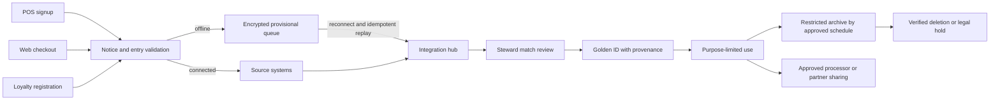
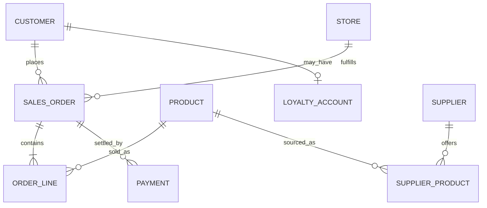
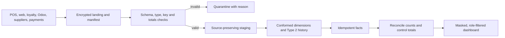

# Project Savanna: Enterprise Data Management Turnaround

**Status:** AI-assisted consultancy draft and runnable demonstration  
**Prepared for:** Savanna Retail Group (SRG)  
**Evidence boundary:** Scenario facts come from the supplied brief. Per the
user's instruction, all data files currently in the workspace were profiled.
The fixture README explicitly calls them fabricated test values; metrics below
are exact for those files, not verified SRG business results. The assignment's
broken-job log and HR workbook are not present.

> **Authorship and integrity:** This draft was prepared with AI assistance.
> Review it, add your own evidence and reasoning, disclose assistance under KIU
> policy, and do not claim personal experience or results that are not yours.
> This is not a legal opinion or a published dashboard.

## Executive briefing

SRG's reported 23% cross-system customer duplication, five product
identifiers, 11-day monthly reporting cycle, 8.4% book-to-physical stock
variance, and delayed response to a stolen laptop are not isolated database
defects. They are symptoms of missing decision rights, inconsistent capture,
unowned reference data, fragmented integration, weak controls, and no trusted
analytical layer. Hiring DBAs alone would improve availability and database
administration, but would not decide which customer record is authoritative,
change store signup behavior during outages, set retention periods, or establish
who reports a suspected breach.

Adopt a **hub-and-spoke, offline-tolerant coexistence design**: store systems
continue operating during outages; a small, centrally managed integration and
master-data hub reconciles signed, idempotent changes when links return. Start
with governance, encrypted exports, reference-data controls, and a batch
warehouse. Add near-real-time processing only to narrow use cases with a
measured business value. A small central team coordinates stewardship through
existing roles; it does not replace operational ownership.

The first six months prioritize measurable controls and quick wins: stop
unencrypted customer exports, establish an incident clock and access register,
standardize product units and customer capture, automate a daily sales
reconciliation, and publish a governed pilot dashboard. The proposed 18-month
envelope totals UGX 480 million including contingency. Before committing funds,
Finance must validate local quotations, recurring costs, taxes, connectivity,
and the distinction between budgeted allocations and actual spend.

## Scenario and evidence

SRG has 23 stores, SavannaShop, 180,000 loyalty members, mobile-money
integrations, siloed POS MySQL databases, e-commerce PostgreSQL, a standalone
loyalty database, SaaS CRM, HQ-only Odoo, local HR/payroll and spreadsheets,
14 supplier spreadsheets, and manual mobile-money CSVs. Store links and power
are intermittent. The data budget is UGX 480M/year, the IT team has four people
(two SQL-capable), and the Board expects visible gains by month 6 and a PDPO
audit within 12 months.

The Jinja incident in the brief involved a stolen laptop with an unencrypted
export of 9,000 customers and an 11-day internal reporting delay. The workspace
contains small CSV/JSON examples for customer, product, sales, suppliers,
loyalty, HR schema, and footfall. It contains neither the named
`SRG_HR.xlsx` nor `etl_error_log.txt`; the available `SRG_HR_SAMPLE.csv` is
one synthetic row, and should not be mistaken for the workbook.

## A1 — EDM diagnostic and customer-data lifecycle

**EDM is the enterprise discipline** for treating data as a governed asset:
decision rights, shared definitions, quality controls, security, privacy,
metadata, integration, retention, and accountable use. **Database management**
is the narrower engineering work of operating schemas, queries, backups,
indexes, access, and availability. DBAs are needed, but cannot alone resolve
the duplicated people across the POS, web, CRM, and loyalty systems or decide
whether a loyalty profile may be matched on a phone number.

| Lifecycle stage | System / actor | Required control | Scenario failure to test |
|---|---|---|---|
| Create / collect | POS cashier, web checkout, loyalty app | Notice, purpose, minimum fields, source and timestamp | Local “quick” records and inconsistent formats |
| Validate | POS/app/web field rules; store steward | Required/format/reference checks; offline queue | Invalid district, phone, duplicate signup |
| Store | Store MySQL, PostgreSQL, loyalty cloud, CRM, Odoo | Named owner, role-based access, encryption, backups | Siloed copies and exports |
| Integrate / master | Integration hub and customer steward | Provenance, idempotent event IDs, match review | Wrong-member points and unsafe auto-merge |
| Use / share | Analysts, marketing, finance, partners | Approved purpose, masked views, logged sharing | Uncontrolled exports and undefined consent |
| Archive | System owner and records steward | Approved schedule, restricted archive, legal hold | Indefinite copies in spreadsheets |
| Delete / prove | Source owners and privacy focal point | Verified deletion across replicas/backups per schedule | No owner or evidence of downstream deletion |

The recurring defects show why a clean-up without changed controls re-creates
the defect on the next transaction. DAMA-DMBOK functions absent or weak in this
scenario include governance, data quality, MDM/reference data, metadata,
architecture/integration, security/privacy, and lifecycle management. The
mapping is in `docs/diagrams/dama-problem-map.mmd`.

Editable source: [customer-lifecycle.mmd](./diagrams/customer-lifecycle.mmd).

## A2 — Governance framework and compliance register

### Charter

**Vision:** timely, explainable, protected data that store and Board decisions
can rely on. **Principles:** business ownership; collection for a stated
purpose; minimum necessary data; quality at entry and monitored downstream;
offline continuity with later reconciliation; traceable changes; least
privilege; retention limits; human review for uncertain identity matches.
**Scope:** customer, product, supplier, store, sales/payment, loyalty, HR, and
footfall data across all 23 stores and digital channels, including processors
and partner exchanges. **Proportionality:** use existing staff and a small
monthly council; no new six-person bureaucracy.

### Operating structure

- **Executive sponsor / accountable controller:** COO (board escalation and
  funding); CFO approves material spend and risk acceptance.
- **Data Governance Council (monthly):** COO (chair), IT lead, Finance lead,
  Retail Operations representative, Marketing/CRM lead, HR lead, and privacy
  focal person. Approves definitions, policy exceptions, cross-domain disputes.
- **Domain owners:** Retail Operations for store/sales; Marketing/CRM for
  customer and loyalty; Merchandising/Procurement for product and supplier;
  Finance for payment/reconciliation; HR lead for workforce records.
- **Stewards (part-time existing staff):** nominated store champions and
  functional analysts maintain definitions, resolve routine quality queues,
  and record exceptions. IT lead is platform custodian, not owner of business
  meaning.
- **Privacy/security:** named privacy focal person coordinates rights and
  incidents with the controller; IT lead operates access, encryption, logging,
  backups, and restoration. Obtain qualified counsel for statutory decisions.

### RACI

R = responsible, A = accountable, C = consulted, I = informed. Roles:
COO/council (GOV), IT lead (IT), business data owner (OWN), domain steward
(STW), privacy focal person (PRIV), CFO (FIN).

| Activity | GOV | IT | OWN | STW | PRIV | FIN |
|---|---:|---:|---:|---:|---:|---:|
| Approve data definitions | A | C | R | R | C | I |
| Create customer at channel | I | C | A | R | C | I |
| Approve customer merge | I | C | A | R | C | I |
| Change product reference | I | C | A | R | I | C |
| Grant production access | I | R | A | C | C | I |
| Approve export / partner share | I | C | A | I | R | C |
| Resolve data-quality incident | I | C | A | R | C | I |
| Approve retention schedule | A | C | R | C | R | C |
| Execute verified deletion | I | R | A | C | C | I |
| Declare / assess breach | I | R | A | I | R | I |
| Approve risk exception | A | C | R | I | C | C |
| Reconcile daily sales | I | C | A | R | I | C |
| Review quarterly access | I | R | A | C | C | I |
| Approve new data attribute | A | C | R | C | C | I |
| Restore after outage | I | R | A | C | I | I |

Exactly one A is shown per row. Council terms of reference should name a
delegate for the privacy focal role and define escalation when a business owner
is also the incident subject.

### Enforceable minimum policies

1. **Access and classification.** Owners classify each field Public, Internal,
   Confidential, or Restricted. Restricted includes identity, contact,
   payment tokens, loyalty history, HR/payroll, and precise footfall data.
   IT grants named, time-limited roles only after owner approval; MFA is
   mandatory for remote/admin access; quarterly recertification; all bulk
   exports encrypted and logged; no unencrypted endpoint copy. The IT lead
   blocks unapproved exports and reports exceptions to the council monthly.
2. **Data quality.** Owners approve a rule, threshold, steward, and remediation
   SLA for each critical field. Reject invalid mandatory data at entry when
   online; while offline, queue it with source/event ID and reconcile later.
   Do not silently substitute values. Daily sales/product exceptions go to
   stewards; suspected identity merges require review. Weekly exception reports
   and monthly threshold breaches go to the owner and council.
3. **Retention and deletion.** Owners propose purpose-specific periods; privacy
   focal person and counsel validate them against legal, tax, employment, and
   contract duties before approval. No invented universal retention period.
   Every export has an owner, purpose, expiry, and deletion receipt. Deletion
   requests are tracked across source and derived copies, subject to verified
   holds; backups expire under a documented rotation. Monthly overdue items
   are escalated to COO.

### Compliance obligations and gaps

Treat Uganda's Data Protection and Privacy Act, 2019 and applicable
regulations/PDPO requirements as the primary framework. Confirm controller and
processor registration/status, lawful and fair collection, notice/consent or
other applicable basis, purpose limitation, security safeguards, data-subject
rights, processor agreements, cross-border safeguards, and incident reporting
against the current Act and PDPO guidance before the audit. The Act is
identified as Act 9 of 2019. The official PDPO site was located, but its
published Act link returned an application shell rather than the statute text
in this verification pass. For that reason, no Uganda section numbers or
statutory notification deadline are asserted here; the controlling provisions,
regulations, and current guidance must be checked by counsel before the audit.
See `docs/legal-citation-review.md` for verification scope and sources.

For the EU-facing partnership, map the [official GDPR text](https://eur-lex.europa.eu/eli/reg/2016/679/oj),
Articles 5–6 (principles/lawfulness),
12–22 (transparency and rights), 25 (privacy by design), 28 (processors),
30 (records), 32 (security), 33–34 (breach notification), 35 (DPIA), and
44–49 (international transfers) to actual processing roles and contracts.
Article 3 defines territorial scope, including processing in the context of an
EU establishment and certain processing by a non-EU controller or processor
offering goods/services to people in the EU or monitoring their behaviour
there. Do not assume GDPR applies to every Ugandan processing activity;
document the establishment, targeting, and monitoring facts with counsel.
Under Article 33, where a personal-data breach is not unlikely to result in a
risk to individuals, the controller must notify the competent supervisory
authority without undue delay and, where feasible, within 72 hours after
becoming aware; if later, reasons for delay are required. Article 34 is a
separate communication duty where the breach is likely to result in a high
risk, subject to its stated exceptions.
CCPA/CPRA is a comparative reference only unless California applicability is
established; assess notice, access/deletion/correction, opt-out, sensitive
data, service-provider, and non-discrimination obligations if triggered.

| Priority | Current gap / evidence | Action | Owner / due |
|---|---|---|---|
| Critical | Unencrypted 9,000-record laptop export; late escalation | Reconstruct incident; preserve evidence; legal assessment; prohibit local exports; disk encryption | COO, IT, privacy focal / 30 days |
| High | Siloed customer collection and uncertain notices/bases | Channel inventory, notice/consent evidence, purpose register and processor contracts | Marketing, privacy / 90 days |
| High | No stated retention/deletion control across spreadsheets | Approved schedule and export registry; deletion proof and holds | Owners, privacy / 120 days |
| High | No cross-border transfer assessment for EU/Kenya/Rwanda | Data-flow map, transfer mechanism/legal review, vendor due diligence | COO, counsel / before transfer |
| Medium | Quality and rights requests have no named queue/SLA | Assign stewards, request and exception registers | Owners / 90 days |

**CFO memo.** Governance is not a new committee tax; it is the set of decisions
needed to make existing IT spend effective. The brief already describes one
avoidable control failure: an unencrypted device carried 9,000 purchase-linked
records and the incident surfaced 11 days late. Likely direct exposure includes
investigation, notification, legal advice, device replacement, staff time,
customer support, partner assurance, and lost trust; quantify only after
Finance estimates SRG's actual unit costs and counsel evaluates applicable
liability. Public comparators show downside can be material: the 2017 Equifax
settlement included up to USD 425M consumer assistance plus USD 175M to states
(FTC/CFPB/States, 2019); Target agreed to a USD 18.5M multistate settlement
after its 2013 breach (state AG announcement, 2017). Verify against the
[FTC Equifax settlement release](https://www.ftc.gov/news-events/news/press-releases/2019/07/equifax-pay-575-million-part-settlement-ftc-cfpb-states-related-2017-data-breach)
and the [NY Attorney General Target settlement release](https://ag.ny.gov/press-release/2017/attorney-general-schneiderman-announces-185-million-settlement-target-data-breach).
These are not forecasts for SRG and must be checked against primary sources
before publication. The
single day-one policy that most directly prevents a repeat is the export/access
policy: no unencrypted endpoint exports, role-based approval, expiry, and
auditable deletion. Staff will violate it if it blocks work during outages;
provide offline-first approved queues and enforce through technical controls,
not posters.

## B1 — Architecture, ER model, normalization

### Pattern decision

Score 1 (poor) to 5 (strong); weighted score = weight × score, divided by 100.
Weights prioritize outage tolerance, affordability, and maintainability over
central uniformity because 23 stores lose connectivity and the four-person IT
team has limited engineering capacity.

| Criterion | Weight | Centralized | Decentralized | Federated | Hub-and-spoke |
|---|---:|---:|---:|---:|---:|
| Offline resilience | 25 | 1 | 5 | 4 | 5 |
| 18-month affordability | 20 | 2 | 4 | 3 | 4 |
| Operability with current skills | 20 | 3 | 2 | 2 | 4 |
| Cross-channel consistency | 20 | 5 | 1 | 4 | 4 |
| Security / auditability | 15 | 4 | 2 | 4 | 4 |
| **Weighted total / 5** | **100** | **2.85** | **2.95** | **3.40** | **4.25** |

These are decision hypotheses, not measured vendor benchmarks. Validate cost,
bandwidth, and recovery assumptions in a 2-store pilot. Reject fully
centralized POS writes because outages would stop sales; reject unmanaged
decentralization because it perpetuates competing identities and product codes.
The selected design keeps transactional autonomy at the edge and sends
versioned changes to a governed hub.

### Core entities and assumptions

The Mermaid ER model is `docs/diagrams/operational-er.mmd`. Orders belong to
one store/channel and contain one or more order lines; a customer may be
anonymous, and guest orders must not be force-matched. Payments are separate
from orders because split tender/refunds are possible. Loyalty membership is
zero/one active account per customer subject to product confirmation. Suppliers
and products are many-to-many via a supplier-product cross-reference omitted
from the minimum assignment entity list but required in implementation.

Assumptions that may break: (1) a “customer” phone is unique—shared family
phones, recycled SIMs, or no-phone shoppers disprove this; (2) a product has one
unit/category—variable-weight goods and packaging changes disprove this; (3) a
store is a stable reporting unit—relocation, franchise ownership, or channel
fulfillment can change its business meaning. Preserve source IDs and effective
dates rather than baking these assumptions into a destructive merge.

### Normalization and reporting trade-off

For an illustrative unnormalized line item
`(receipt, date, customer, store, product1, qty1, product2, qty2, payment1,
payment2)`, repeating product/payment groups violate 1NF. Convert to one row
per order line with atomic attributes and a line number; separate order header,
product, customer, store, and payment entities. Then remove partial dependencies
(line attributes depend on `(order_id,line_no)`, not only order_id) for 2NF and
transitive dependencies such as district name depending on store_id for 3NF.
The available workspace files include small fabricated examples; no
assignment-scale unnormalized extract is present. This is a worked pattern,
not a claim that it exactly matches the available fixture columns.

One deliberate denormalization is a daily store-product sales aggregate in the
warehouse. It reduces dashboard scan cost and supports stock planning; it is
rebuildable from immutable transaction lines, carries a refresh timestamp, and
is never the operational stock ledger. Reconcile totals to the source before
publishing.

## B2 — Data quality and cleansing

The runnable demo profiles completeness, validity, consistency, uniqueness,
accuracy proxy, and timeliness proxy before and after standardizing customer
phone/district/name and product SKU/unit/category. Accuracy and timeliness
cannot be established from syntax alone: they require a trusted external
reference or source timestamp and business context. The script therefore
labels these as proxy measures. It preserves suspicious records for review,
does not guess invalid districts, and emits a candidate list rather than
silently deleting duplicate people.

The workspace contains eight customer rows and six product rows. The fixture
README describes these records as fabricated. The figures below are
reproducible calculations on those available files, not scenario-scale
estimates.

| Demo measure | Before | After | Interpretation |
|---|---:|---:|---|
| Customer rows complete for name, phone, district | 7/8 (87.5%) | 7/8 (87.5%) | Missing phone remains missing; no value is invented |
| Phone syntax accepted | 6/8 (75%) | 6/8 (75%) | Formatting is standardized, but malformed/absent values still need review |
| District mapped to demo reference | 7/8 (87.5%) | 7/8 (87.5%) | Unknown district is retained for steward review |
| Creation date parsed unambiguously | 7/8 (87.5%) | 7/8 (87.5%) | Ambiguous date is not guessed |
| Distinct phone format categories | 3 | 2 | Valid forms normalize to E.164; unresolved values remain flagged |
| Distinct date format categories | 4 | 2 | Parsed values are ISO; ambiguous/invalid dates remain visible |
| Customer duplicate candidates | 1/8 (12.5%) | 1/8 (12.5%) | Candidate remains reversible and awaits human decision |
| Product unit spellings | 6 | 3 | Common aliases normalize to canonical units |
| Product category values accepted | 5/6 (83.33%) | 6/6 (100%) | Demo typo maps to a category; owner approval is required in production |
| Product duplicate SKU candidates | 1/6 (16.67%) | 1/6 (16.67%) | Case-normalized duplicate is flagged, not deleted |

Accuracy and timeliness are explicitly unmeasured because no trusted reference,
arrival timestamps, or agreed freshness SLA are available in the fixtures.
The machine-readable before/after rows, numerator/denominator, and limitations
are in `output/quality_metrics.csv`.

The current sales fixture has 8/8 rows complete across the ten required
non-conditional fields; 7/8 (87.5%) pass implemented validity checks. One
ambiguous slash-date row is quarantined. All 8 currency strings pass the
three-letter syntax check (not ISO-reference validation); 1/8 payment
references are absent. No duplicate order/line keys are observed. The sole
negative-quantity row has a return reason (1/1). Accepted lines total UGX
50,400 net and 9 net units after the return.

The supplier file has 2/2 complete rows, both SKU crosswalks resolve to the
product fixture, and both unit strings are recognized; Procurement has not
verified the mappings. Loyalty has 3/3 complete rows, 3/3 customer IDs resolve
within the customer fixture, all 3 balances parse as non-negative integers,
and there are no repeated account IDs. Point balances cannot be reconciled
without transaction events.

The one-row HR schema sample contains candidate restricted fields
`bank_account`, `health_note`, `phone`, and `pay_band`. Its values are
placeholders, not real employee data. The assignment workbook is absent.
Footfall has 3/3 events with required keys and parseable timezone-aware
timestamps, no repeated event IDs, and no enumerated direct identifier fields.
Three events are insufficient to establish privacy or stream-latency guarantees.
Cross-source row-level rules and the hashes of every available input are in
`output/workspace_dataset_inventory.csv` and
`output/workspace_quality_profile.csv`; the narrative is in
`output/workspace-data-profile.md`.

**Point-of-entry validation catalog (12 minimum):** required source-system
record ID; transaction idempotency key; district from stewarded list; phone
stored with country/extension semantics; date parse with ISO output; email
syntax plus verification status; product SKU cross-reference; quantity numeric
and returns reason required when negative; currency ISO code; payment reference
nullable only with documented tender exception; unit of measure from controlled
list; customer consent/purpose event when applicable; event time and source
system on every change; foreign keys valid or explicitly pending-sync offline
queue. Online writes reject invalid mandatory values; offline stores queue the
event with the same checks on sync.

**Continuous monitoring:** daily feed by source and store; duplicate candidates
<1% new customer registrations routed for review; invalid district <0.5%;
unmapped SKU <0.5%; rejected transaction <0.1%; unexplained stock variance
>2% or a 3-sigma jump triggers same-day inventory investigation. These are
initial service thresholds to approve during baseline, not measured facts.
Steward triages by next business day; owner resolves systemic cause within
five working days; IT pages the incident lead for missing/late critical feeds.

**8.4% stock variance fishbone:** the brief's 8.4% is a scenario-reported
baseline, not independently calculated. The causal hypotheses (unit conversion,
late/duplicate offline sync, returns/voids, shrinkage, supplier pack-size
changes, delayed receiving, cycle-count practice, and reconciliation timing)
must be tested with matched SKU/store/time data. See
`docs/diagrams/stock-variance-fishbone.mmd`. Do not treat a recount or mass
adjustment as root-cause correction.

## B3 — Customer master data management

Choose **coexistence**: retain source applications and local customer IDs while
assigning a hub `golden_customer_id`, source crosswalk, provenance, confidence,
and survivorship. A registry alone cannot resolve/update the loyalty process;
centralized replacement is over budget and outage-prone; consolidation-only
analytics does not operationally return a resolved identity. Start in
consolidation mode for a two-store pilot, then enable approved cross-reference
updates after false-merge tests.

Golden-record survivorship is attribute-specific: verified loyalty profile
wins for explicit preferences/consent; CRM may win preferred contact only when
recently verified and purpose permits; POS/web source values remain immutable
observations and never overwrite verified attributes solely because they are
newer. Name/address require source, timestamp, and confidence; address is
effective-dated. No source silently overwrites consent. Keep every candidate
value and the survivorship decision for audit.

Candidate matching scores: exact source-system ID crosswalk 100; verified
phone 35; normalized name 25; email 25; district 10; date-of-birth match only
if lawfully collected and approved 15; cap at 100 and penalize conflicting
verified attributes. Auto-link only exact crosswalk or score ≥95 with at least
two independent matching attributes and no hard conflict. 75–94 goes to a
trained steward; below 75 stays separate. The percentages/weights are pilot
starting points, not statistically calibrated probabilities. Measure false
merge and missed-match rates against reviewed pairs before expansion. A wrong
merge can expose purchases/preferences and transfer another person's loyalty
benefit; provide reversible links, audit trail, unmerge workflow, and rights
review.

During outages, permit a locally generated provisional ID with source prefix,
device ID, UUID, and creation timestamp. Queue idempotent events; do not assign
another customer's points until matching is confirmed. Politically, the store
manager owns customer service and participates in pilot acceptance; centrally
owned ID rules do not mean a cashier must wait on a live network.

## B4 — Integration, warehouse, broken ETL, streaming

The warehouse star schema is `FactSales` at order-line/payment allocation grain
with `DimDate`, `DimProduct` (Type 2), `DimStore` (Type 2), `DimCustomer`
(privacy-limited), `DimChannel`, `DimTender`, and degenerate source transaction
ID. Separate `FactInventorySnapshot`, `FactLoyaltyActivity`, and
`FactFootfallAggregate` avoid mixing incompatible grains. Loyalty/contact
details remain outside general analytics.

Batch extraction uses read-only incremental queries/change timestamps where
available; otherwise encrypted scheduled exports or store edge queues with
sequence/checksum. SaaS APIs use vendor-supported pagination and quotas. HR
spreadsheets are manually approved, minimized, encrypted, and loaded only for a
defined workforce metric. Supplier workbooks land in quarantine with file hash,
sender, schema check, and steward approval. Mobile money files reconcile on
daily batch, not millisecond streaming. Transform to ISO dates, decimal
quantities, ISO currency codes, canonical units, source-preserving keys, and
effective-dated dimensions. Load dimensions, crosswalks, facts, then aggregates
in one logged transaction or restartable batch. Reject/quarantine invalid rows;
never drop them without a count and reason.

`sql/etl-core.sql` shows restartable staging-to-warehouse transformation
patterns. `docs/diagrams/etl-workflow.mmd` and `integration-flows.mmd` are
editable visuals. For a future cloud move, ETL is preferred initially: fewer
skills and explicit controls before loading. ELT becomes attractive when a
managed warehouse is funded, raw-zone access is restricted, transformations
are tested/versioned, and costs are monitored. A scorecard is in the decisions
register.

**Local ETL test evidence:** `scripts/test-postgres.ps1` loads seven accepted
synthetic order lines into `staging.sales_line`, runs the ETL twice, and checks
that exactly seven fact rows remain, the ambiguous-date input is not promoted,
and the negative return is preserved. The script passes in
`savanna_edm_demo`; `output/postgres-demo-verification.txt` contains final
assertions, `output/postgres-demo-etl-log.txt` contains the execution
transcript, and `output/postgres-access-test.txt` records the allowed masked
view and denied restricted-table access. The schema/RBAC were applied to that
local database. These prove only the demo SQL path, not integration with SRG
systems or validity of the scenario's 60,000 transactions.
See [finalization-checklist.md](./finalization-checklist.md) for all outstanding
evidence and student-specific submission steps.

Editable source: [etl-workflow.mmd](./diagrams/etl-workflow.mmd).

**Broken job diagnosis:** the requested `etl_error_log.txt` does not exist in
the complete workspace inventory, so a specific failure/root cause is not
evidenced and cannot be inferred. The executed local SQL job is not broken:
seven rows staged, seven rows loaded, and the second run retained seven facts
using the composite source key. P002 is rejected because `04/01/2026` could
mean 4 January or 1 April; the negative return is retained. The RBAC test's
`permission denied` is expected and proves restricted access. It is not an ETL
failure. The diagnostic sequence for a later-supplied log remains in
`docs/etl-log-diagnosis-template.md`; the run-level evidence is
`output/postgres-demo-etl-log.txt`.

**Real-time, narrowly:** footfall events can update an aggregated occupancy /
queue indicator for store managers if sensors are approved, coarse, and
non-identifying. No camera or person-level identity join. Stock visibility
needs near-real-time only for selected high-demand SKUs; POS events queue at
the edge and publish after reconnect, with freshness shown. Mobile-money fraud
patterns should begin with daily reconciliation and fast exception alerts for
duplicate references/amounts; payment-provider feeds, fraud base rates, latency
needs, privacy, and false-positive handling must justify any stream processor.
Do not stream all sales merely because the Board says “real time.” The stream
path is sensor → local buffer → authenticated broker → schema validation and
coarse aggregation → alert/dashboard; dead-letter queue and retention controls
are mandatory.

## C1 — Metadata, lineage, and catalog

`docs/data-dictionary.csv` contains 38 warehouse fields with business,
technical, and administrative metadata, owner, sensitivity, and quality tags.
Use tags `domain:*`, `sensitivity:*`, and `quality:*`; e.g.
`domain:customer`, `sensitivity:restricted`, `quality:verified`. Steward reviews
definitions quarterly and on schema change; IT records technical lineage at
deployment; the owner approves semantic changes. Address-schema impact
analysis traces staging → `DimCustomer` → active-customer KPI → churn/segment
dashboard and export/API consumers. A migration adds structured locality /
district / address lines while maintaining a versioned compatibility view,
backfill and reconciliation, then deprecates old free text after consumer
sign-off.

Editable source: [metadata-lineage.mmd](./diagrams/metadata-lineage.mmd).

For this team, begin with versioned CSV/SQL metadata and PostgreSQL comments;
evaluate OpenMetadata against Microsoft Purview in a time-boxed pilot. Apache
Atlas is also a credible open-source alternative but can require more platform
operations than four staff can sustain. Choose a paid service only if its
annual total cost, residency, access integration, support, and contract terms
beat a lightweight catalog. No vendor price is asserted; procurement must
collect quotes.

## C2 — Security, privacy, incident response

The threat model includes stolen/unlocked devices, insider export, phishing and
credential theft, ransomware, vendor compromise, store power/connectivity loss,
shared accounts, spreadsheet leakage, insecure backups, and mistaken
cross-customer matches. The prioritized 12-item register is
`docs/risk-register.csv`; likelihood and impact are 1–5, initial score is their
product, and residual ratings require owner sign-off.

`sql/rbac.sql` creates least-privilege roles and a negative-access test for
restricted customer data. `scripts/profile-and-clean.ps1` writes a separate
masked customer file; masking is pseudonymization, not anonymization. In
production require TLS, volume/database encryption, centrally managed keys,
rotation and recovery testing, MFA, endpoint disk encryption, secrets
management, backups, audit logging, and quarterly access recertification.
Analytics roles use masked aggregates. Do not place real customer data in this
repo.

The EU-loyalty DPIA working template is
`docs/dpia-loyalty-eu.md`. Its release gates include necessity/proportionality,
lawful basis and clear notices, consent withdrawal where consent is the basis,
minimization, retention, matching error impact, child/household treatment,
processor contracts, international transfers, rights handling, security tests,
and a DPO/supervisory consultation decision with counsel.

**Rewrite of the Jinja response:** staff notify the named incident lead
immediately through a 24/7 contact tree; IT isolates the device/account,
revokes sessions/keys, preserves evidence, records discovery time and scope,
and does not wipe evidence before coordination. Privacy focal person and
controller assess data, persons, encryption, likely harm, processors, and
jurisdiction with counsel; notify the GDPR supervisory authority within the
applicable Article 33 window if GDPR applies and its risk threshold is met.
Assess Article 34's separate high-risk communication duty and exceptions. For
Uganda, establish the applicable notice duty and timeline against verified
Act/regulation text and current PDPO guidance rather than importing the
GDPR's 72-hour period. Keep decision rationale, notices, remediation, and
lessons in a register; test the process quarterly. The 11-day internal delay
is a control failure regardless of whether statutory notification ultimately
was required.

Audit checklist: registration/status confirmed; processing inventory and
lawful purposes recorded; notices/version evidence present; processor terms
signed; rights queue tested; transfer assessments approved; retention and
deletion evidence available; encryption/access recertified; incident tabletop
completed; DPIA approved; data-quality owners assigned. Mark each item
Pass/Fail/Not evidenced only after reviewing records.

## C3 — Analytics and emerging technology

Board questions: (1) which customer cohorts are retained or churning, using
consented loyalty activity and a disclosed inactivity window; (2) which
products/store pairs have repeated stock-outs or excess days-on-hand; (3) which
segments grow by channel and margin, not just gross sales; (4) where do
reconciliation exceptions cluster by provider/reference; (5) which expansion
stores meet demand, connectivity, fulfillment, and profitability thresholds?

Workflow: source → quarantine → validation → conformed dimensions and facts →
reconciliation → role-filtered semantic dataset → dashboard → decision
log/action owner. Dashboard design uses explicit dates, currency, grain,
filter/drill controls, and missing-data state. `dashboard/index.html` is an
offline demonstration generated from the seven accepted sales fixture rows;
it filters by month/district/channel/category and has three drill-down charts.
The records are explicitly marked synthetic and are too few for meaningful
business trend conclusions. `dashboard/dashboard-demo.png` is a screenshot;
`dashboard/demo-data.js` is reproducibly generated from cleaned rows. For
Tufte/Few review, reject 3-D pies,
unlabeled dual axes, and a raw record-level table; use small multiples,
denominator-visible rate charts, and exception details behind an access check.

**Tableau Public publication status:** not yet published. Tableau Public
2023.2 is installed, the Tableau Public website sign-in is complete, and the
safe aggregate CSV was imported and a local worksheet is open, showing seven
marks and total net sales of UGX 50,400. Native HTTPS requests to Tableau
Public's `/app` routes now return HTTP 200, but the desktop **Save to Tableau
Public** embedded sign-in still fails with `ERR_CONNECTION_RESET`; no public
workbook or view is published and there is no live public URL. A safe import
file,
`dashboard/workspace-synthetic-sales-aggregates.csv`, is generated from the
accepted cleansed rows and contains grouped measures only, not customer or
transaction identifiers. Follow `docs/dashboard-publication.md` to import and
retry desktop authentication (or use an updated Tableau Public client) and
publish the view. Tableau Public makes published work and data public, so only
this synthetic aggregate should be used. Add the genuine public URL here only
after testing it signed out. The local HTML demo is not a live Tableau link.

**Technology choices:** pilot managed cloud object storage + PostgreSQL
warehouse + managed scheduler only after cost, region, connectivity, backup,
and processor review. Do not adopt a full lakehouse or data mesh now: skills,
team size, governance maturity, and budget do not justify it. Pilot automated
rule-based anomaly detection first; defer AI identity matching until reviewed
ground truth, bias tests across names/languages/districts, human override, and
appeal path exist. A 2-year maturity goal is repeatable governed reporting,
defined quality SLAs, lineage for critical KPIs, and an audited self-service
semantic layer—not autonomous decisions.

For an explicit maturity assessment, use a five-level capability rubric:
Level 1 ad hoc, Level 2 repeatable, Level 3 defined, Level 4 measured/managed,
Level 5 optimized. On the scenario evidence, SRG is between Levels 1 and 2:
some operational systems and reports exist, but consolidation is manual,
definitions and owners are unclear, and quality/security controls are not
consistently measured. This is a provisional assessment rather than an audit
result. Target Level 3 for governed monthly reporting, named owners, repeatable
quality checks, lineage for critical KPIs, and tested access/incident
processes within two years. Do not target Level 4–5 until source feeds and
stewardship are reliable.

## D1 — 18-month roadmap and budget

| Phase | Milestones and governance gate | UGX M |
|---|---|---:|
| M0–3: contain and baseline | Export ban/encryption, incident tabletop, inventory and owners, baseline DQ, procure pilot | 90 |
| M4–6: visible wins | Two-store offline queue pilot, product reference cleanup, daily sales reconciliation, first governed dashboard; council accepts measures | 115 |
| M7–12: integrate and assure | Customer coexistence pilot, Type-2 warehouse dimensions, rights/retention tests, PDPO audit evidence, DPIA and vendor review | 165 |
| M13–18: scale selectively | Rollout based on pilot exit criteria, refresh SLAs, recovery test, KPI benefit review, next-year decision | 59 |
| Controlled contingency | COO + CFO approval, documented change and risk; not a hidden spend target | 51 |
| **Total** | Within the stated annual envelope; verify cash-flow and recurring run-rate | **480** |

| Allocation | UGX M | Arithmetic / scope |
|---|---:|---|
| Staff backfill, training, steward time | 72 | Existing staff time and practical training |
| Store connectivity, edge buffering, UPS | 50 | Pilot first; quote 23-store rollout |
| Endpoint/database security, backup and key controls | 65 | Encryption, MFA, logs, tested restore |
| Software, support, catalog/BI | 45 | Annual license/support cap; procurement quotes required |
| Integration and warehouse implementation | 90 | Pilot setup, testing, monitored jobs |
| Privacy/legal/audit readiness | 40 | Counsel, DPIA, processor/transfer reviews |
| Data quality and MDM rollout | 45 | Steward workflow, crosswalk, reference controls |
| Dashboard and adoption | 22 | Role-filtered semantic layer, user training |
| Contingency | 51 | 10.625% of total; controlled release |
| **Total** | **480** | **72+50+65+45+90+40+45+22+51** |

Gate each phase on owner sign-off, security testing, source reconciliation,
staff readiness, and spend-to-date. Quick-win success at M6: encrypted exports
and incident SLA tested; daily report delivered by next business day; SKU
exceptions assigned; two-store queue completes replay without duplicate
orders; dashboard refresh timestamp and reconciliation pass are visible.

**Coherence:** governance assigns definitions/owners → entry rules and stewards
reduce recurring defects → reviewed customer/product crosswalks enable
integration → metadata and lineage preserve meaning → privacy/security constrain
use and sharing → reconciled, role-filtered analytics supports inventory,
customer, and payment decisions.

## D2 — decisions, critique, reflection, viva

Eight decisions and the evidence that could reverse them are in
`docs/decision-log.csv`. The strategy is vulnerable: the four-person IT team
may not sustain integrations; store staff can route around controls if the
network fails; managers may reject centrally governed IDs; “coexistence” can
become one more sync service; licensing and cross-border transfer costs may
exceed assumptions; and a council may be captured by senior owners who suppress
quality issues. Countermeasures are deliberately modest: two-store pilot,
offline queue, service-level ownership, reconciliation and rollback, open
exports, per-phase procurement gates, and escalation to COO. If training and
connectivity cannot be funded, slow rollout rather than silently weakening
privacy controls. A 50% budget cut means retain incident controls, backup,
access, minimum quality ownership, and daily finance reconciliation; defer
real-time streaming, broad cloud migration, catalog purchase, and nonessential
analytics.

**Reflective essay:** use the separately marked working draft in
`docs/reflective-essay-draft.md`. Its career-path section is intentionally
unfilled because the student's intended career and experience were not
provided. Replace that section truthfully and review the entire essay before
use. Do not claim a certification or field experience not held. Viva
preparation should include: why coexistence beats centralization; what happens
to an offline signup; which match causes a manual review; how the stock
variance is actually diagnosed; what evidence changes the 8.4% baseline; how a
failed partial ETL is replayed; what the 50%-budget plan defers; and which
legal conclusions require counsel.

## Reproducibility and submission evidence

Run the demo and keep generated outputs separate from source fixtures. For a
real assessment, capture: original-file hashes and received dates; pipeline
version/command; row counts before/after; before/after metrics; quarantined
records and reason codes; unauthorized SQL test output; dashboard refresh
timestamp; reconciliation results; and reviewer sign-offs. Create a PDF from
the reviewed report only after replacing every pending item with supported
evidence and checking the 40-page limit. No missing input is represented as a
successful result.
